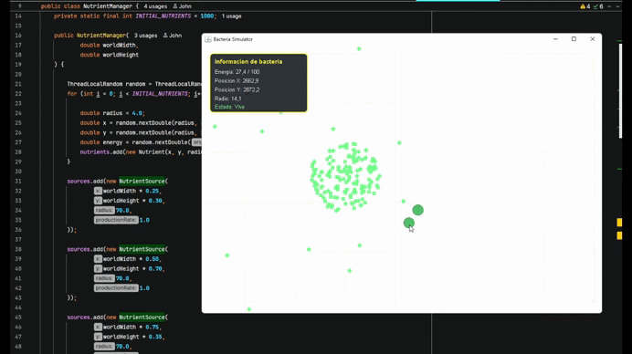

# Bacteria — Artificial Ecosystem 2D

<p align="center">
  <a href="https://translate.google.com/translate?sl=en&tl=es&u=https://github.com/OWNER/REPO" target="_blank" rel="noopener noreferrer">
    
  </a>
  <a href="https://translate.google.com/translate?sl=en&tl=ja&u=https://github.com/OWNER/REPO" target="_blank" rel="noopener noreferrer">
    
  </a>
</p>

A Java-based simulation of a 2D artificial bacterium ecosystem. The application renders a large world, supports camera navigation, and simulates bacteria that move, consume nutrients, reproduce, and eventually die when their energy runs out.



## Description

This project is a foundation for exploring:

- Agent-based simulation and emergent behavior
- 2D graphics with Swing and Java 2D
- Camera movement and zoom controls
- Nutrient management and resource distribution
- Evolution of a synthetic population
- Simple behavior rules such as food seeking, collision avoidance, and reproduction

The simulation is intended as an educational prototype and conceptual research tool, not as an exact biological model of real bacteria.

## Current status

The first version includes:

- A 2D world larger than the visible window
- Camera pan and zoom centered on the cursor
- Grid reference lines for navigation
- An initial bacterial population
- Nutrients distributed across the map
- Nutrient sources that regenerate resources
- Autonomous movement toward nearby food sources
- Separation behavior between bacteria to avoid crowding
- Energy consumption and death due to depletion
- Reproduction when enough energy is available
- Selection and display of a targeted bacterium

## Requirements

- Java 21 or later
- Maven 3.9+
- An IDE such as IntelliJ IDEA or Eclipse (optional)

## Project structure

```text
Bacteria-EcosistemaArtificial2D/
├── pom.xml
├── README.md
├── docs/
│   └── PROJECT_BACTERIA.md
├── src/
│   └── main/
│       └── java/
│           └── com/
│               └── ecosystem/
│                   └── simulation/
│                       ├── Main.java
│                       ├── WorldPanel.java
│                       ├── Camera.java
│                       ├── Bacterium.java
│                       ├── BacteriaManager.java
│                       ├── Nutrient.java
│                       ├── NutrientManager.java
│                       ├── NutrientSource.java
│                       └── ...
└── target/   (generated by Maven)
```

## Running the project

### Option 1: from IntelliJ IDEA

1. Open the project in IntelliJ IDEA.
2. Make sure the project is configured to use Java 21.
3. Find the class `com.ecosystem.simulation.Main`.
4. Click Run.

### Option 2: from the command line

From the project root:

```bash
mvn compile
java -cp target/classes com.ecosystem.simulation.Main
```

If you want to launch it directly with Maven:

```bash
mvn exec:java -Dexec.mainClass=com.ecosystem.simulation.Main
```

> Note: Maven must be installed and available in your PATH, and a compatible Java version must be installed.

## Controls

- Click and drag: move the camera
- Mouse wheel: zoom in/out
- Simple click on a bacterium: select the entity
- The world updates in real time according to the simulation loop

## Main architecture

### `Main`

Application entry point. Creates the main window and loads the world panel.

### `WorldPanel`

Swing panel that draws the simulation, handles mouse events, and updates the world each frame.

### `Camera`

Keeps the camera position and zoom level. Converts world coordinates to screen coordinates and vice versa.

### `Bacterium`

Represents a bacterium with position, energy, movement, and survival/reproduction logic.

### `BacteriaManager`

Controls the population, updates, and reproduction behavior across the ecosystem.

### `NutrientManager`

Manages the nutrients in the world and the generation of new resources from distributed sources.

## Roadmap

### Current phase

- Ecosystem visualization
- Navigable camera
- Reactive population behavior
- Resources and reproduction

### Planned improvements

- Smarter bacterium AI
- Mutation and evolution system
- Population and energy statistics
- More refined collision and collective behavior
- Automated tests and performance optimization

## License

This project is still under development and does not yet define a formal license. If you intend to use or expand it, check with the repository owner first.

## Notes

This is the first version of the README. It will be updated as the simulation, architecture, and features continue to evolve.

### Translation note

The buttons above direct to Google Translate for the repository page. If you want them to point to the exact GitHub URL of this project, replace `OWNER/REPO` in the links above with your actual repository name.
